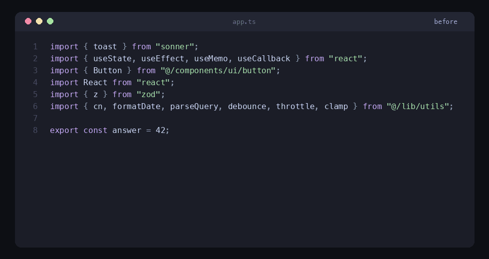

# Import Ladder

[](https://github.com/kyoresuas/import-ladder/actions/workflows/ci.yml)
[](https://github.com/kyoresuas/import-ladder/releases/latest)
[](https://code.visualstudio.com/)
[](LICENSE)

> Sort TypeScript/JavaScript imports as a ladder - ascending by length. Extension for VS Code and Cursor.



```ts
// before
import { ServiceException } from "@smithy/smithy-client";
import { Readable } from "stream";
import { S3Client, _Object, ObjectCannedACL, __MetadataBearer, GetObjectCommand, HeadObjectCommand, ListObjectsCommand, DeleteObjectCommand, ListObjectsV2Command } from "@aws-sdk/client-s3";
import { randomUUID } from "crypto";
import sharp, { FormatEnum, FitEnum } from "sharp";
import { Upload } from "@aws-sdk/lib-storage";

// after
import {
  _Object,
  S3Client,
  ObjectCannedACL,
  __MetadataBearer,
  GetObjectCommand,
  HeadObjectCommand,
  ListObjectsCommand,
  DeleteObjectCommand,
  ListObjectsV2Command,
} from "@aws-sdk/client-s3";
import { Readable } from "stream";
import { randomUUID } from "crypto";
import { Upload } from "@aws-sdk/lib-storage";
import sharp, { FitEnum, FormatEnum } from "sharp";
import { ServiceException } from "@smithy/smithy-client";
```

## Sorting rule

One simple rule, the same for single-line and multi-line imports: **sort by the length of the `from "module"` line, ascending.**

- single-line -> length of the whole line
- multi-line -> length of the closing `} from "module";` line

Inside `{ ... }` the named specifiers are sorted the same way (by name length, alphabetical as a tie-break).

This produces a consistent staircase effect regardless of whether you have a tiny `import { toast } from "sonner";` or an expanded block of 9 named specifiers.

## Install

### From .vsix

1. Download `import-ladder-x.y.z.vsix` from the [latest release](https://github.com/kyoresuas/import-ladder/releases/latest), or build it locally: `npm install && npm run compile && npx @vscode/vsce package`.
2. In Cursor/VS Code: `Cmd+Shift+X` -> **…** menu -> **Install from VSIX…** -> pick the file.
3. `Cmd+Shift+P` -> `Developer: Reload Window`.

### Local development

```bash
git clone https://github.com/kyoresuas/import-ladder
cd import-ladder
npm install
```

Open the folder in VS Code, hit **F5** to launch an Extension Development Host.

## Usage

### Command

`Cmd+Shift+P` -> **Sort Imports Ladder** — sorts imports in the active file.

### On save, before Prettier

In `settings.json`:

```json
{
  "editor.codeActionsOnSave": {
    "source.sortImports.ladder": "explicit"
  }
}
```

The sort runs before Prettier formats the file.

### On save, after Prettier

In `settings.json`:

```json
{
  "sortImport.formatOnSave": true
}
```

Useful when Prettier rewrites line breaks inside imports and you want the final pass to be the ladder.

## Settings

| Key | Type | Default | Description |
|---|---|---|---|
| `sortImport.formatOnSave` | `boolean` | `false` | Sort imports after the file is saved (runs after Prettier). |
| `sortImport.printWidth` | `number` | `80` | Max line width. Anything longer is broken into multi-line. |
| `sortImport.indentSize` | `number` | `2` | Indent (in spaces) inside multi-line imports. |
| `sortImport.useTabs` | `boolean` | `false` | Use tabs instead of spaces for multi-line indent. |
| `sortImport.quote` | `"\""` \| `"'"` | `"\""` | Quote style for the module string. |

## Prettier compatibility

The extension can run either before or after Prettier (see above). Keep `sortImport.printWidth` in sync with `printWidth` in your `.prettierrc` — otherwise Prettier and the extension may disagree on whether a given import should be single-line or multi-line.

## ESLint

The same order can be enforced in CI and in editors without the extension, with [eslint-plugin-perfectionist](https://github.com/azat-io/eslint-plugin-perfectionist). Its `line-length` sort measures a whole import, and `maxLineLength` makes imports that Prettier wraps sort by their closing `} from "module";` line, which is exactly the ladder rule.

```js
// eslint.config.js
import perfectionist from "eslint-plugin-perfectionist";

export default [
  {
    plugins: { perfectionist },
    rules: {
      "perfectionist/sort-imports": [
        "error",
        {
          type: "line-length",
          order: "asc",
          maxLineLength: 80, // same value as printWidth in .prettierrc
          sortSideEffects: true,
          groups: [],
          newlinesBetween: "ignore",
        },
      ],
      "perfectionist/sort-named-imports": [
        "error",
        {
          type: "line-length",
          order: "asc",
          fallbackSort: { type: "alphabetical" },
        },
      ],
    },
  },
];
```

ESLint only reorders, Prettier does the wrapping, and the extension does both in one pass. Checked on hundreds of randomly shuffled import blocks (eslint-plugin-perfectionist 5.13, ESLint 9): the order matches the extension whenever no two imports have the same length.

## What's supported

- `import { a, b } from "x";` - named
- `import x from "y";` - default
- `import x, { a, b } from "y";` - default + named
- `import * as ns from "x";` - namespace
- `import "polyfill";` - side-effect (kept in the sort order)
- `import type { A } from "x";` - type-only
- `import { type A, B } from "x";` - inline `type` modifier
- CRLF/LF, `#!shebang`, leading `"use strict";`, leading comment block

## What's NOT supported

- Comments between imports — the sort block only spans consecutive `import` statements.
- Re-exports (`export { x } from "y";`) — left untouched.
- Grouping by source (external vs local) — sort is purely by length.

## Architecture

```
src/
  types/index.ts   - public types and defaults
  parser.ts        - parses source into ParsedImport[]
  renderer.ts      - renders an import back to text, sorts named specifiers
  sorter.ts        - orchestrator: parse -> render -> sort by from-line length
  extension.ts     - VS Code glue: command, code action, save hook
test/
  sorter.test.ts   - Vitest cases
```

The logic in `sorter.ts`/`parser.ts`/`renderer.ts` has no VS Code dependency and is tested directly.

## Development

```bash
npm test           # single run
npm run test:watch # watch mode
npm run compile    # build to out/
npm run watch      # tsc in watch mode
npx vsce package   # build .vsix
```

## License

MIT
